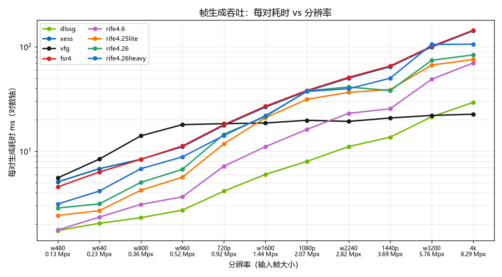
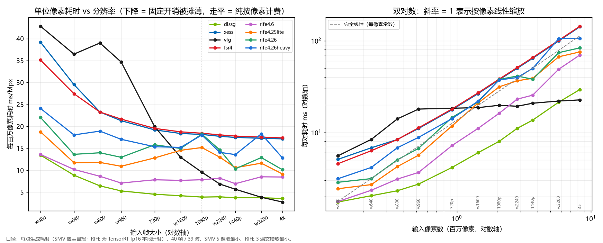
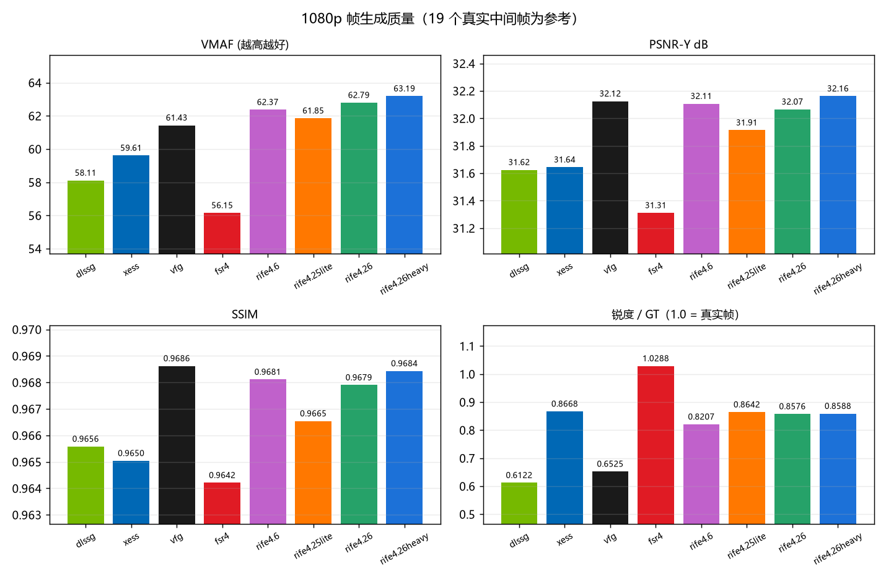
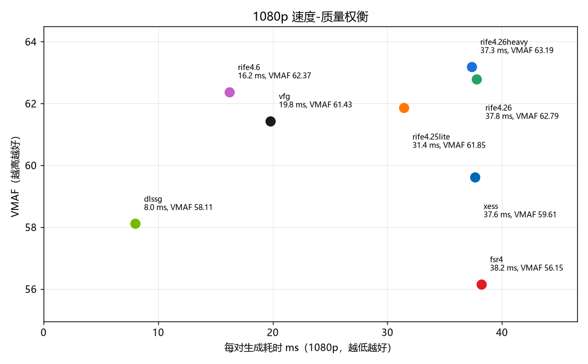
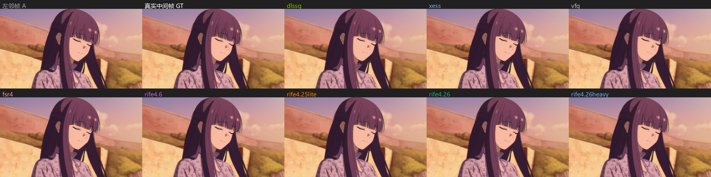

# bench — 八引擎视频插帧基准

`vs-framegen` 仓库的一部分：插件源码在 `../vs-dlssg/src`，这里只放基准。

在同一台机器、同一段素材、同一套计时口径下，横向比较 8 个 2 倍速帧生成引擎的
**吞吐随分辨率的变化**与 **1080p 生成质量**。

测试机：RTX 3080 10 GB（Ampere sm_86）· 素材：1080p 动漫片段 40 张连续帧
（40 帧 → 39 个插帧对，19 个偶数帧是真中间帧，可白拿 GT）· 2026-11-19。

| 引擎 | 实际是什么 | 驱动方式 | 备注 |
|---|---|---|---|
| `dlssg` | NVIDIA DLSS Frame Generation | `smv-live.exe --dlssg` → `dlssg2f.exe` + `dlssg_for_sm86` 代理 | 3080 官方不支持，靠代理解锁 |
| `xess` | Intel XeSS Frame Generation | `smv-live.exe --xess-fg` | 走 fsrfg 桥接 |
| `vfg` | NVIDIA Video Effects 帧生成 | `smv-live.exe --nvvfg` | `nvVFXVideoFrameGeneration.dll` |
| `fsr4` | AMD FidelityFX FSR 帧生成 | `smv-live.exe --fsrfg` | `amd_fidelityfx_framegeneration_dx12` |
| `rife4.6` | Practical-RIFE 4.6 | TensorRT fp16，本地喂 ONNX | |
| `rife4.25lite` | Practical-RIFE 4.25 Lite | 同上 | |
| `rife4.26` | Practical-RIFE 4.26 | 同上 | |
| `rife4.26heavy` | Practical-RIFE 4.26 Heavy | 同上 | |

四个硬件后端借 [SmoothMyVideo] 的离线宿主统一驱动；四个 RIFE 变体是在
`vs-mlrt` 的 ONNX 模型上自己搭的 TensorRT runner（11 通道输入，见
[`docs/method.md`](docs/method.md)）。**DLL、模型、宿主程序都不在本仓库内**，
仓库只有脚本、结果快照和图表。

## 结论

| 问题 | 答案 |
|---|---|
| 谁最快 | **DLSSG**，480×270 → 3200×1800 这 10 档都是第一（1080p 8.00 ms/pair，约 250 fps 输出），4K 以 29.38 ms 让位给 VFG |
| 谁最稳 | **VFG**，耗时几乎与分辨率无关（18.4 → 22.6 ms），4K 反超 DLSSG 拿第一（88 fps 输出） |
| 谁最慢 | **XeSS-FG / FSR4**，在 sm_86 上纯按像素计费（1080p ≈38 ms，4K ≈143 ms/pair），不可用 |
| 谁最好看 | **RIFE 全系**：`rife4.26heavy` VMAF 63.19（19 帧里赢 13 帧），`rife4.6` 62.37 且是 RIFE 里最快的（1080p 16.20 ms） |
| 谁最省 | 追求"又快又能看"的折中是 **`rife4.6`**：比 `rife4.26heavy` 快 2.3 倍，VMAF 只差 0.8 |
| DLSSG 的短板 | 画面最软（锐度只有真实帧的 0.61 倍），VMAF 58.11 排第 7 |

## 吞吐曲线（ms/pair，2×，5 遍取最小）



11 档分辨率阶梯（480×270 → 3840×2160），纵轴对数：

| 引擎 | 480p | 640p | 800p | 960p | 720p | 1600p | 1080p | 2240p | 1440p | 3200p | 4K |
|---|---|---|---|---|---|---|---|---|---|---|---|
| dlssg | **1.74** | **2.04** | **2.31** | **2.73** | **4.15** | **6.00** | **8.00** | **11.07** | **13.63** | **21.37** | 29.38 |
| vfg | 5.55 | 8.40 | 14.04 | 17.97 | 18.36 | 18.63 | 19.77 | 19.29 | 20.82 | 22.00 | **22.63** |
| xess | 5.08 | 6.80 | 8.37 | 11.03 | 17.68 | 26.44 | 37.63 | 50.00 | 64.38 | 99.48 | 142.13 |
| fsr4 | 4.55 | 6.32 | 8.37 | 11.22 | 17.99 | 26.98 | 38.19 | 50.95 | 65.50 | 101.06 | 143.98 |
| rife4.6 | 1.76 | 2.34 | 3.10 | 3.66 | 7.19 | 11.05 | 16.20 | 23.05 | 25.49 | 48.87 | 69.97 |
| rife4.25lite | 2.43 | 2.70 | 4.23 | 5.64 | 11.79 | 20.92 | 31.42 | 36.57 | 38.93 | 66.77 | 75.58 |
| rife4.26 | 2.86 | 3.13 | 5.03 | 6.70 | 14.55 | 21.52 | 37.78 | 41.22 | 37.99 | 74.14 | 83.63 |
| rife4.26heavy | 3.12 | 4.16 | 6.80 | 8.83 | 14.14 | 21.87 | 37.34 | 39.68 | 49.94 | 105.28 | 105.92 |

输出帧率（fps = 2000 / ms，2 倍速输出口径）：

| 引擎 | 720p | 1080p | 1440p | 4K |
|---|---|---|---|---|
| dlssg | 482 | 250 | 147 | 68 |
| vfg | 109 | 101 | 96 | 88 |
| xess | 113 | 53 | 31 | 14 |
| fsr4 | 111 | 52 | 31 | 14 |
| rife4.6 | 278 | 123 | 78 | 29 |
| rife4.25lite | 170 | 64 | 51 | 26 |
| rife4.26 | 137 | 53 | 53 | 24 |
| rife4.26heavy | 141 | 54 | 40 | 19 |

### 每百万像素的耗时



左图是 ms/Mpx：曲线**下降**说明固定开销被摊薄，**走平**说明纯按像素计费。
DLSSG 从 13.4 → 3.5 ms/Mpx，VFG 从 42.8 → 2.7（4K 每像素最便宜），
XeSS/FSR4 从 720p 起稳定在 17–19 ms/Mpx，RIFE 各变体接近水平。

## 质量（1080p，19 个真实中间帧）



| 引擎 | VMAF ↑ | PSNR-Y ↑ | SSIM ↑ | MAE ↓ | 锐度/GT | 赢帧 |
|---|---|---|---|---|---|---|
| rife4.26heavy | **63.19** | **32.16** | **0.9684** | 0.008458 | 0.859 | **13** |
| rife4.26 | 62.79 | 32.07 | 0.9679 | 0.008518 | 0.858 | 1 |
| rife4.6 | 62.37 | 32.11 | 0.9681 | 0.008413 | 0.821 | 0 |
| rife4.25lite | 61.86 | 31.91 | 0.9665 | 0.008739 | 0.864 | 2 |
| vfg | 61.43 | 32.13 | 0.9686 | 0.008270 | 0.653 | 3 |
| xess | 59.61 | 31.64 | 0.9650 | 0.008876 | 0.867 | 0 |
| dlssg | 58.11 | 31.63 | 0.9656 | 0.008773 | 0.612 | 0 |
| fsr4 | 56.15 | 31.31 | 0.9642 | **0.009288** | 1.029 | 0 |

「锐度/GT」是 Laplacian 方差比：< 1 偏软，> 1 过锐。DLSSG 与 VFG 明显偏软
（0.61 / 0.65），FSR4 反过来最硬也最不准。

### 速度-质量取舍



### 逐帧目视对比

`results/compare/` 有三组（帧 0006 / 0020 / 0034），每组三张：
`panel_*`（左邻帧 A | 真值 GT | 8 个引擎）、`zoom_*`（最繁忙区域的 1:1 裁剪）、
`diff_*`（|生成 − GT| ×4 放大）。



## 快速开始

前置：Windows + NVIDIA GPU、Python 3.12 虚拟环境（`torch`、`tensorrt`、
`onnxruntime`、`opencv-python`、`numpy`、`matplotlib`）、带 `libvmaf` 的 ffmpeg，
外加仓库外的三份资产：

| 资产 | 默认位置（相对 `VFI_ROOT`） | 说明 |
|---|---|---|
| 源帧 | `测试数据\1080p\0001..0040.png` | 40 张连续帧 |
| SmoothMyVideo 便携版 | `参考插件\SmoothMyVideo-protable\resources\engine` | 需打过 sm_86 解锁补丁 |
| RIFE ONNX 模型 | `测试环境\mpv-lazy\vs-plugins\models\rife` | 四个变体 |

`VFI_ROOT` 缺省是本仓库的父目录；换机器时用环境变量指向资产所在的项目根：

```powershell
$env:VFI_ROOT      = "E:\code\dlssg-vfi"
$env:VFI_DATA      = "E:\code\dlssg-vfi\测试数据\engines"   # 结果输出目录
$env:TRT_CACHE     = "E:\code\dlssg-vfi\work\engines"       # TRT engine 缓存
```

跑一遍完整流程（约 40 分钟，绝大部分是每分辨率一次的 TRT 编译）：

```powershell
python src\run_throughput.py             # 11 档 × 8 引擎 → $VFI_DATA\throughput.json
python src\run_quality.py                # 1080p 生成帧 → $VFI_DATA\quality\frames
python src\metrics.py                    # VMAF/PSNR/SSIM/MAE/锐度 → quality.json|csv
python src\make_charts.py                # 5 张图 → $VFI_DATA\charts
python src\make_compare.py               # 9 张对比图 → $VFI_DATA\quality\compare
```

可选过滤：`run_throughput.py 720p 1080p vfg rife4.6`（分辨率与引擎名都可当位置参数），
`--force` 重测已有条目。探针在 `src\probes\`：`probe_smv.py`（五个后端冒烟）、
`probe_rife_layout.py`（11 通道布局自证）、`probe_dynamic_engine.py`（动态 vs 静态
TRT bucket）、`probe_vfg_size.py`（VFG 尺寸敏感性）。

4K 素材上的插件 API 对比图（`docs\benchmark\pv-compare-*.png`，DLSS-G/XeSS-FG/VFG/FSR4 的
2×2 生成帧 + 真实帧）：

```powershell
python src\scan_pv_motion.py             # 扫全片相邻帧 PSNR，挑运动适中的时刻
python src\make_pv_compare.py --force    # 抽 n/n+1/n+2，逐引擎生成中间帧并拼图
```

`make_pv_compare.py` 为每个引擎各起一个进程（`src\pv_engine_frame.py`），因为 NGX 每进程
只能初始化一次；素材是 `测试数据\阿哈角色PV 4k.mkv`，靠 `参考插件\...\ffmpeg.exe` 抽帧。

## 目录

```
bench/
├─ src/
│  ├─ common.py          素材、分辨率阶梯、引擎表、读图辅助（唯一配置入口）
│  ├─ smv_run.py         smv-live 离线宿主封装（解析 stderr 的 ms/pair）
│  ├─ rife_trt.py        RIFE 11 通道 TensorRT runner
│  ├─ trt_runner.py      ONNX → TRT engine 构建与执行
│  ├─ run_throughput.py  11 档 × 8 引擎吞吐
│  ├─ run_quality.py     1080p 生成帧落盘
│  ├─ metrics.py         ffmpeg libvmaf + numpy 指标
│  ├─ make_charts.py     吞吐曲线 / 每像素耗时 / 质量 / 散点
│  ├─ make_compare.py    拼图、放大、差分
│  └─ probes/            一次性探针
├─ results/              结果快照（小文件）：json/csv、图表、报告
└─ docs/method.md        测量口径、公式与踩过的坑
```

生成帧序列（`quality/frames`，303.9 MB）、TRT engine、裸流缓存放仓库外：
它们能从脚本重建，塞进 git 只会让 clone 变成一次大文件搬运。

## 读数前请先看

- **本表的口径不是"纯 GPU 时间"**。SMV 侧取宿主自报的 `X ms per pair`，含宿主
  把裸帧从 stdin 读进显存的那一段（1080p 每帧 6.2 MB）。DLSSG 在这一口径下是
  8.00 ms/pair；同一张卡上 `vdlssg` 插件自报的 GPU 合成时间只有 1.58 ms。
  两者不可直接比较，比较引擎之间才有意义。
- **长跑噪声不小**：同档位跨轮差异可达 5–40%（`rife4.26` 的 1080p 读到过 25.21
  与 37.78），所以 20% 以内的引擎差不要当结论。这里用的是「5 遍取最小」
  + RIFE 四模型交错，只压低了系统性偏差，压不掉 SM 时钟漂移。
- 明细、异常清单与每一处已知偏差见 [`results/report.md`](results/report.md)，
  计时与质量的完整定义见 [`docs/method.md`](docs/method.md)。

## 致谢与商标

八个引擎、模型与运行库分属各自厂商/作者：NVIDIA（DLSS、Video Effects）、
Intel（XeSS）、AMD（FidelityFX）、[hzwer/Practical-RIFE]、
[AmusementClub/vs-mlrt]，宿主借 [SmoothMyVideo]。本仓库不含上述任何二进制，
只做测量与呈现。名称与商标归各自所有者。

[SmoothMyVideo]: https://github.com/flowreen/SmoothMyVideo
[hzwer/Practical-RIFE]: https://github.com/hzwer/Practical-RIFE
[AmusementClub/vs-mlrt]: https://github.com/AmusementClub/vs-mlrt
