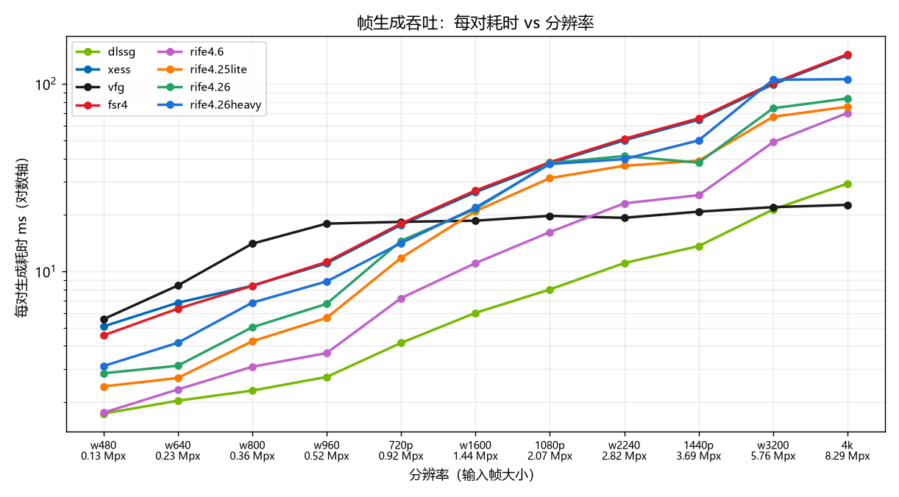
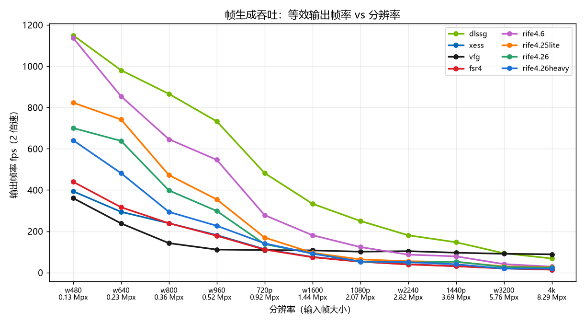
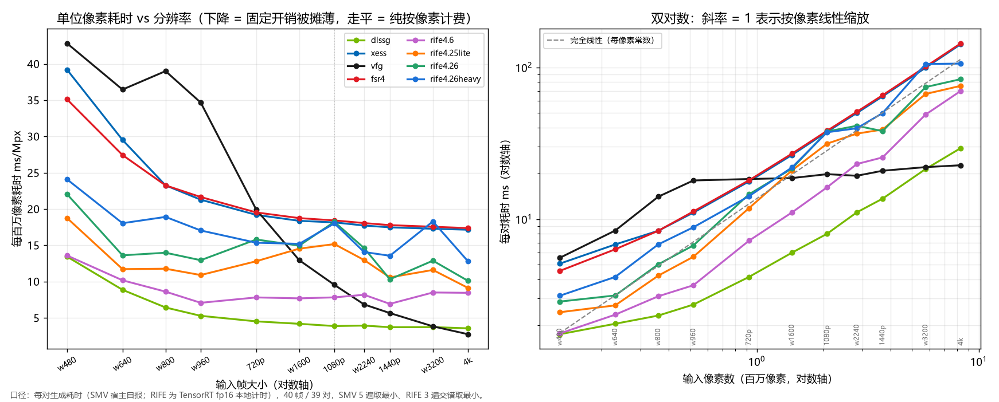
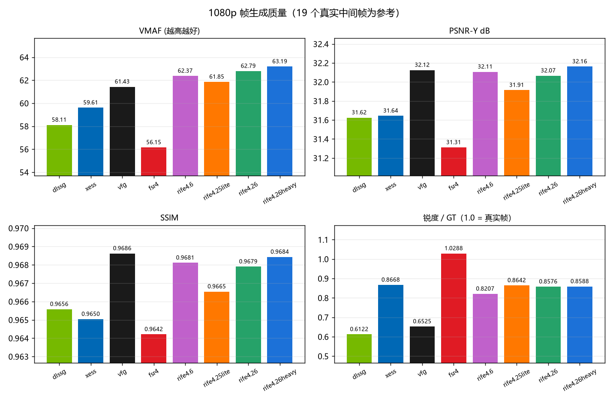
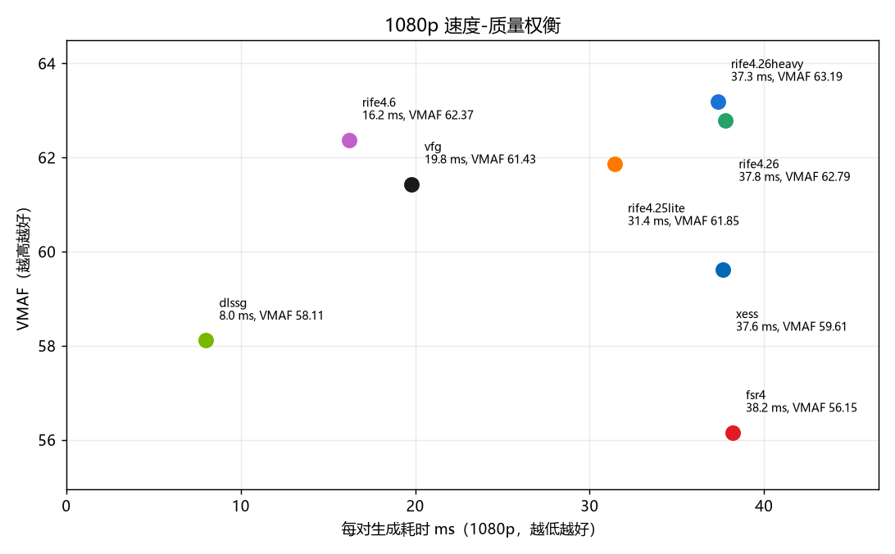
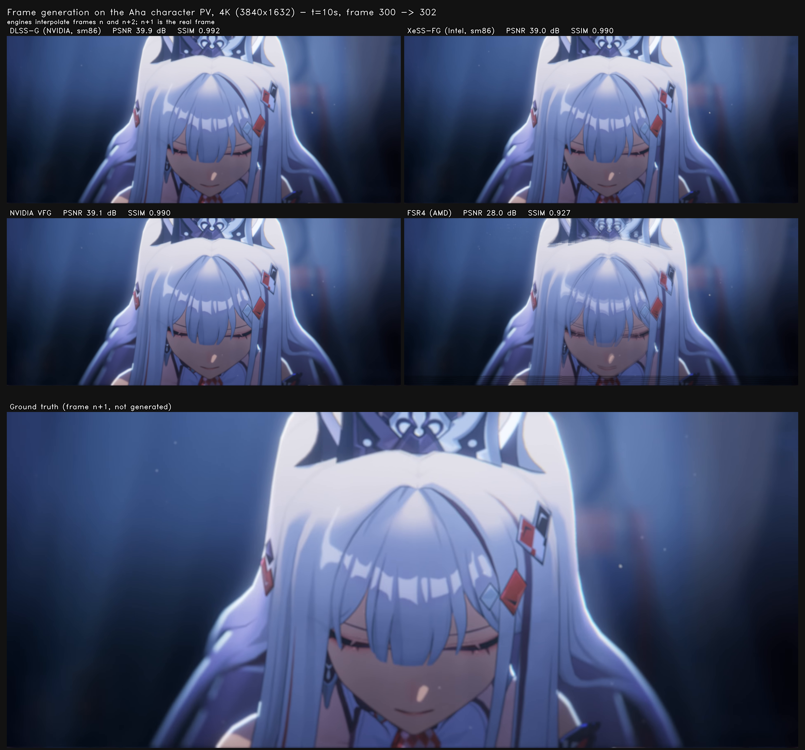
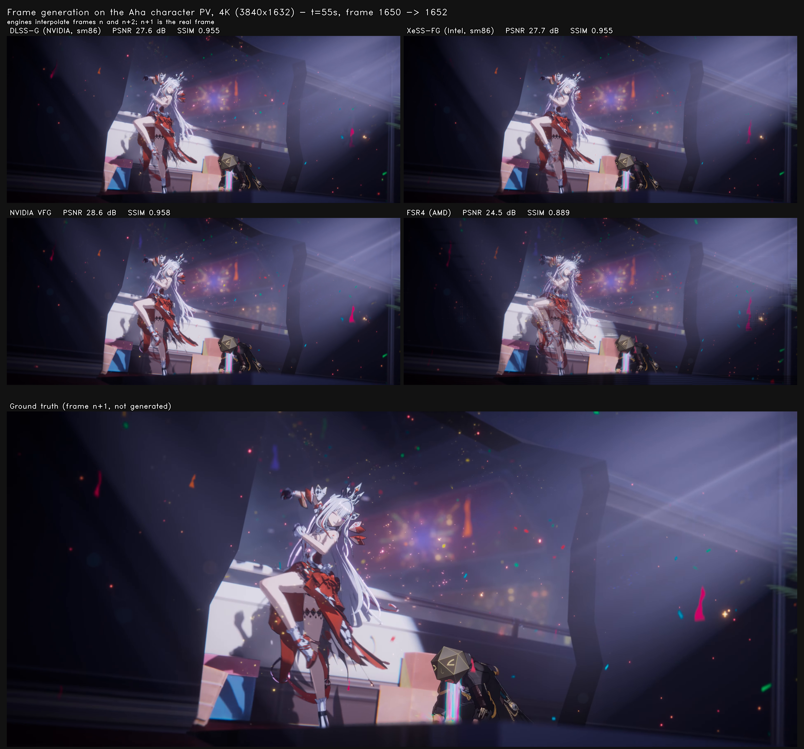
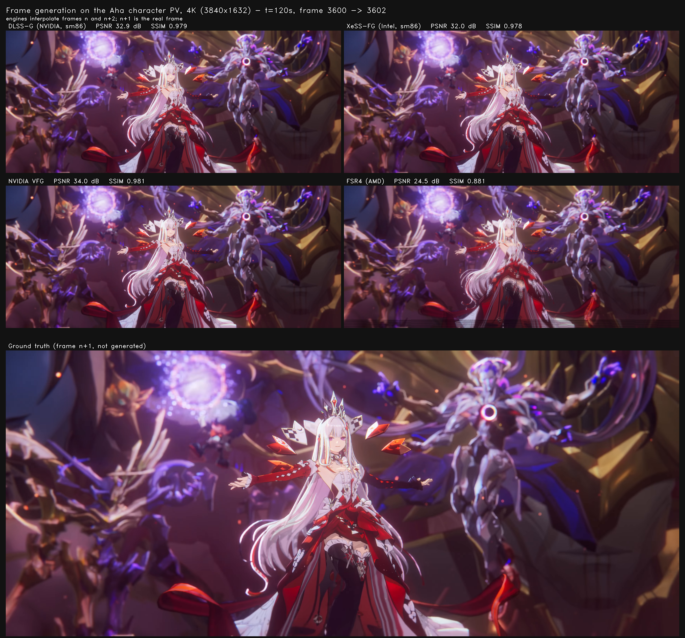

# 基准：八个引擎的吞吐与质量

2026-11-19，RTX 3080 10GB（sm_86）×2，驱动 617.42，Windows 11。
被测引擎：本仓库四个插件（`vdlssg` / `vxessfg` / `vvfg` / `vfsr4`，NVIDIA 三个走 `bin\dlss45`、`bin\xessfg`、`bin\vfg` 的运行时包，FSR4 走 `bin\fsr4`），
以及 RIFE 四个变体（`rife4.6` / `4.25lite` / `4.26` / `4.26heavy`，vs-mlrt 的 11 通道 ONNX + TensorRT fp16）。
全部为 **2 倍速**（每对输入帧生成 1 帧）。

生成帧与逐帧指标留在工作盘（`测试数据\`），仓库里放结论、图表与可复现的原始数字：

| 内容 | 位置 |
|---|---|
| 吞吐原始数据（11 档分辨率 × 8 引擎，ms/pair） | [`bench/results/throughput.json`](../bench/results/throughput.json) |
| 质量原始数据（19 个真实中间帧 × 8 引擎，VMAF/PSNR/SSIM/MAE/锐度） | [`bench/results/quality.json`](../bench/results/quality.json) |
| 完整报告（含每档分辨率、每引擎明细与坑） | [`bench/results/report.md`](../bench/results/report.md) |
| 基准脚本（SMV 宿主 + RIFE + 指标 + 出图） | [`bench/README.md`](../bench/README.md) · [`bench/docs/method.md`](../bench/docs/method.md) |
| 简版小结（不进图片） | [`engines-benchmark.md`](engines-benchmark.md) |

## 一句话结论

**DLSSG 在 1080p 及以下最快**（1080p 8.00 ms/对），但画面最软（锐度 0.61× 真实帧）；
**VFG 的耗时几乎与分辨率无关**（18.4→22.6 ms），4K 反超 DLSSG 拿第一；
**质量由 RIFE 系列领跑**（`rife4.26heavy` VMAF 63.19，19 个真实中间帧里赢 13 帧，`rife4.6` 62.37 且更快）；
**FSR4 与 XeSS-FG 在 30 系上又慢又差**（4K ≈143 ms/对，VMAF 56.2 / 59.6），日常不建议。

## 吞吐





ms/pair，2 倍速，每档跑 5 遍取最小值（RIFE 3 遍交错取最小），越低越好：

| 引擎 | 480 | 640 | 800 | 960 | 720p | 1600 | 1080p | 2240 | 1440p | 3200 | 4K |
|---|---|---|---|---|---|---|---|---|---|---|---|
| dlssg | **1.74** | **2.04** | **2.31** | **2.73** | **4.15** | **6.00** | **8.00** | **11.07** | **13.63** | 21.37 | 29.38 |
| vfg | 5.55 | 8.40 | 14.04 | 17.97 | 18.36 | 18.63 | 19.77 | 19.29 | 20.82 | 22.00 | **22.63** |
| xess | 5.08 | 6.80 | 8.37 | 11.03 | 17.68 | 26.44 | 37.63 | 50.00 | 64.38 | 99.48 | 142.13 |
| fsr4 | 4.55 | 6.32 | 8.37 | 11.22 | 17.99 | 26.98 | 38.19 | 50.95 | 65.50 | 101.06 | 143.98 |
| rife4.6 | 1.76 | 2.34 | 3.10 | 3.66 | 7.19 | 11.05 | 16.20 | 23.05 | 25.49 | 48.87 | 69.97 |
| rife4.25lite | 2.43 | 2.70 | 4.23 | 5.64 | 11.79 | 20.92 | 31.42 | 36.57 | 38.93 | 66.77 | 75.58 |
| rife4.26 | 2.86 | 3.13 | 5.03 | 6.70 | 14.55 | 21.52 | 37.78 | 41.22 | 37.99 | 74.14 | 83.63 |
| rife4.26heavy | 3.12 | 4.16 | 6.80 | 8.83 | 14.14 | 21.87 | 37.34 | 39.68 | 49.94 | 105.28 | 105.92 |

分辨率阶梯同时给出输入像素量（`480=0.13 Mpx … 4K=8.29 Mpx`），横轴按像素数等比排列。

### 每百万像素耗时



这条曲线区分「固定开销」和「按像素的成本」：

- **DLSSG** 13.4 → 3.5 ms/Mpx：小分辨率被固定开销支配，大分辨率单位成本最低（但绝对时间仍随像素线性增长）。
- **VFG** 42.8 → 2.7 ms/Mpx：典型的固定成本主导 —— 4K 时每像素最便宜，所以总耗时几乎持平。
- **XeSS-FG / FSR4** 从 720p 起稳定在 17–19 ms/Mpx：纯按像素计算，且系数最高，4K 直接 143 ms/对。
- **RIFE 四变体** 接近水平带（d≈9–20 ms/Mpx），越重的变体系数越高。

## 质量（1080p，19 个真实中间帧）



8 个引擎、19 个真实中间帧（来自动漫素材，取每对输入帧的中间帧做参考），指标均对参考帧计算：

| 引擎 | VMAF | PSNR-Y | SSIM | MAE | 锐度/GT | VMAF 赢帧 |
|---|---|---|---|---|---|---|
| rife4.26heavy | **63.19** | **32.16** | 0.9684 | 0.00846 | 0.859 | **13** |
| rife4.26 | 62.79 | 32.07 | 0.9679 | 0.00852 | 0.858 | 1 |
| rife4.6 | 62.37 | 32.11 | 0.9681 | 0.00841 | 0.821 | 0 |
| rife4.25lite | 61.85 | 31.91 | 0.9665 | 0.00874 | 0.864 | 2 |
| vfg | 61.43 | 32.12 | **0.9686** | 0.00827 | 0.652 | 3 |
| xess | 59.61 | 31.64 | 0.9650 | 0.00888 | 0.867 | 0 |
| dlssg | 58.11 | 31.62 | 0.9656 | 0.00877 | 0.612 | 0 |
| fsr4 | 56.15 | 31.31 | 0.9642 | 0.00929 | **1.029** | 0 |

两个补充口径：

- **锐度/GT** 是生成帧高频能量与真实中间帧之比，<1 表示偏软。<0.65 的 `dlssg`、`vfg` 就是观感上「糊」的来源；
  `fsr4` 反而 >1（锐化过冲，PSNR 掉到 31.3 且 VMAF 垫底）。
- **VMAF 赢帧**：19 个真实中间帧里该引擎 VMAF 最高的帧数，`rife4.26heavy` 13 帧、`vfg` 3 帧、`rife4.25lite` 2 帧。

### 速度-质量折中



横轴 1080p 每对耗时（对数），纵轴 VMAF。左上角最好：

- `vfg` 是唯一同时进入「20 ms 内 + VMAF 61+」的引擎，代价偏软。
- `rife4.6` 16.2 ms / 62.37 是纯质量-速度折中最优点（比 DLSSG 慢 2 倍，VMAF 高 4.3）。
- `rife4.26heavy` 质量最高但 37.3 ms，1080p 只有 27 fps 输入才够用。

## 4K 实拍素材的生成帧 2×2 对比

基准里的 1080p 素材是动漫帧，质量差异容易被高频线稿放大。为看真实观感，
从 4K 素材 `测试数据\阿哈角色PV 4k.mkv`（3840×1632，30 fps，189.5 s）取三个代表时刻，
每个时刻喂引擎「第 n 帧 + 第 n+2 帧」，取它生成的中间帧，与真实第 n+1 帧对比。

三个时刻按**相邻帧 PSNR 26–34 dB** 挑（`bench\src\scan_pv_motion.py` 扫全片 5–185 s，每 5 s 抽三帧算相邻 PSNR）：
太低的（<20 dB，快速横摇 + 粒子特效）任何插帧都会发虚，太高的（>45 dB）各引擎几乎一样。

### ① t=10 s 脸部特写



| 引擎 | PSNR | SSIM |
|---|---|---|
| dlssg | **39.91** | **0.9919** |
| xessfg | 38.95 | 0.9901 |
| vfg | 39.13 | 0.9901 |
| fsr4 | 27.97 | 0.9272 |

### ② t=55 s 舞台中景



| 引擎 | PSNR | SSIM |
|---|---|---|
| dlssg | 27.55 | 0.9550 |
| xessfg | 27.66 | 0.9554 |
| vfg | **28.60** | **0.9582** |
| fsr4 | 24.54 | 0.8887 |

### ③ t=120 s 多人全景



| 引擎 | PSNR | SSIM |
|---|---|---|
| dlssg | 32.89 | 0.9792 |
| xessfg | 32.00 | 0.9775 |
| vfg | **33.99** | **0.9812** |
| fsr4 | 24.46 | 0.8815 |

三个 NVIDIA 引擎互有胜负、差距都在 1 dB 内；**FSR4 每次都明显最差（低 4–12 dB）**，
与 1080p 基准里它 VMAF 垫底、锐化过冲的结论一致。注意这里的素材是 30 fps 的 PV，
镜头运动和粒子很多，绝对 PSNR 比静止素材低是正常的，看的是引擎之间的相对差距。

## 口径与坑（读数字前请先看）

- **噪声 5–40%**：GPU 时钟漂移让同一档分辨率重跑的极差可达 ±40%（小分辨率最明显）。
  表里是「多遍取最小」，比较 1 ms 级别的差异不可靠，比较 2 倍以上差距可靠。
- **sm_86 是解锁路径**：DLSS-G / XeSS-FG 跑在 RTX 20/30 系上靠 `dlssg_for_sm86` 代理把模式替换成本地编译的 sm86 cubin，
  Ada 显卡上数字会明显不同（尤其 XeSS-FG 的 4K）。详见 [`vdlssg-adapter.md`](vdlssg-adapter.md)。
- **DLSS-G 无运动矢量**：本插件的 `mv` 输入可选，基准里四个引擎都不喂运动矢量（公平起见），
  所以 DLSS-G 的「偏软」有一部分来自没有运动矢量的光学流估计。
- **VFG 显存**：4K + `multi=6` 需要 >10 GB，3080 10GB 该组合会失败；基准固定 `multi=2`。
- **RIFE 的 TensorRT engine 是可丢弃缓存**：`work\engines\*.engine` 删掉会重建，
  但动态 engine 在非 opt 形状上慢 3–12%（均值 1.049×）；profile 的 min 形状必须 tile 对齐（`360 != 384` 这类会被拒）。
- **11 通道布局**：vs-mlrt 的 RIFE ONNX 需要 ch6=t、ch7/8=meshgrid、ch9=2/(W-1)、ch10=2/(H-1)，
  只喂 7 通道输出会整体错位（MAE≈0.24）。

## 复现

```bat
E:\code\VFI\.venv\Scripts\python.exe bench\src\run_throughput.py          :: 11 档 × 8 引擎
E:\code\VFI\.venv\Scripts\python.exe bench\src\run_quality.py             :: 1080p 质量
E:\code\VFI\.venv\Scripts\python.exe bench\src\metrics.py                 :: VMAF/PSNR/SSIM
E:\code\VFI\.venv\Scripts\python.exe bench\src\make_charts.py             :: results\charts\*.png
E:\code\VFI\.venv\Scripts\python.exe bench\src\make_compare.py            :: results\compare\*.png
```

两组图出自不同脚本：`bench\` 的 `make_compare.py` 出 1080p 动漫素材的 panel/zoom/diff；
本页的 4K 2×2 图出自 `bench\src\make_pv_compare.py`（`python bench\src\make_pv_compare.py --force`），
每个引擎各起一个进程（NGX 每进程只能初始化一次）。

脚本与依赖见 [`bench/README.md`](../bench/README.md)；方法细节与踩过的坑见 [`bench/docs/method.md`](../bench/docs/method.md)。
