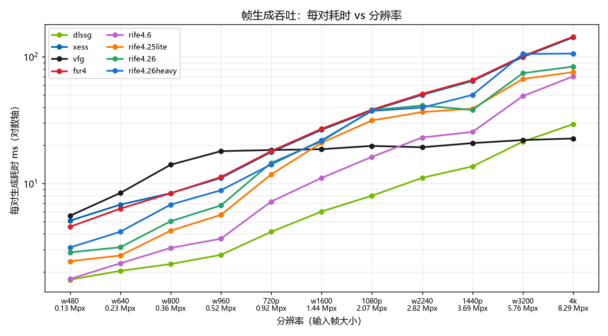
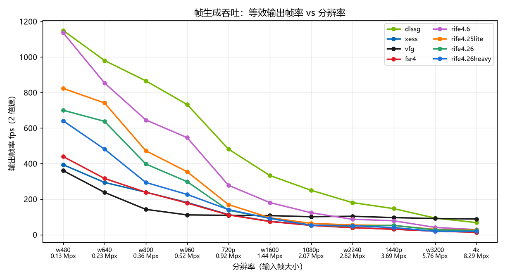
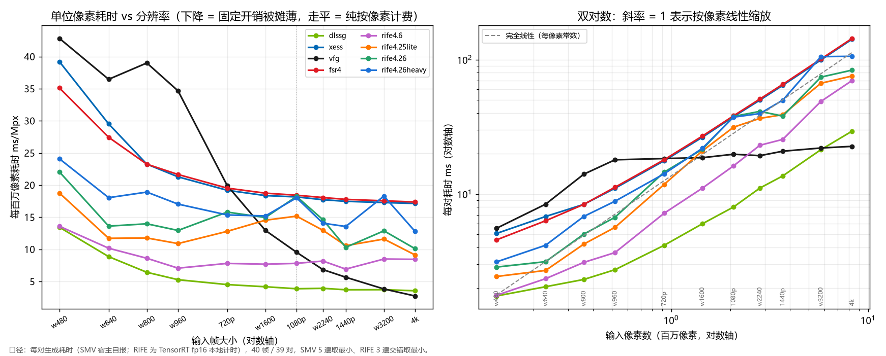
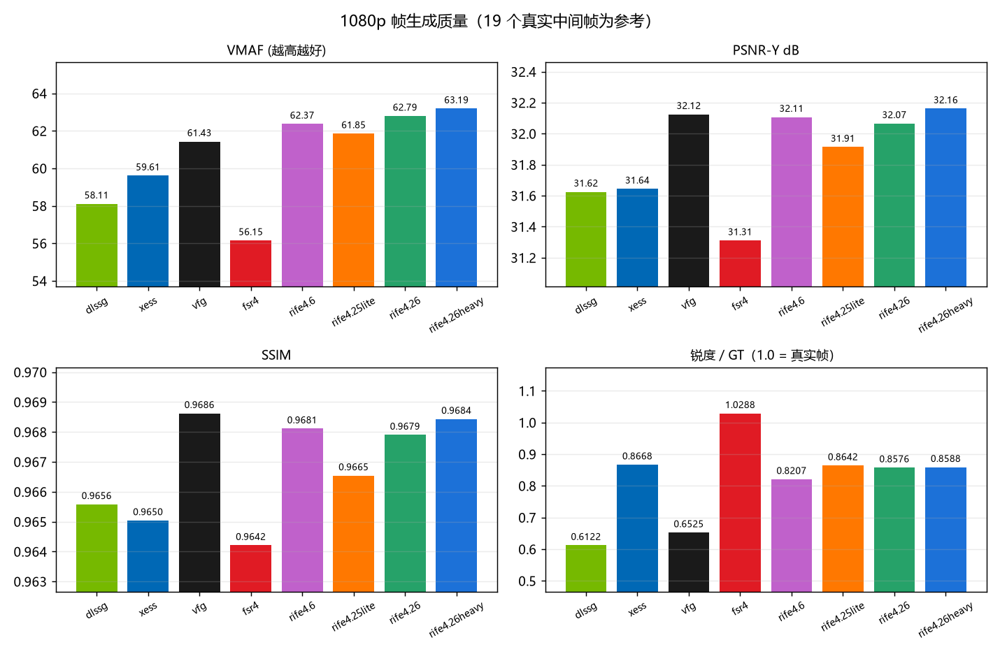
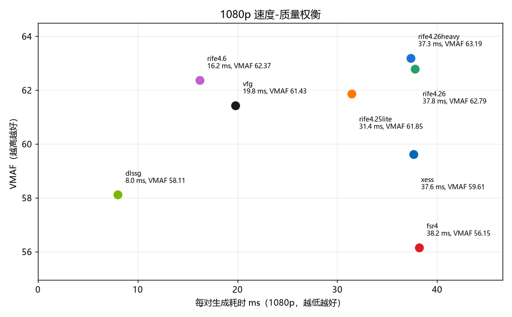

# 八种帧生成引擎：多分辨率吞吐 + 1080p 质量

日期 2026-11-19 · GPU RTX 3080 10GB (sm_86) · 全部数据由 `src\` 下的脚本生成

## 结论摘要

- **吞吐（2 倍速，每对生成帧耗时 ms/pair，全表 11 档分辨率见下）**：DLSSG 在所有分辨率都是绝对最快（720p 4.15 / 1080p 8.00 / 1440p 13.63 / 4K 29.38 ms），而且是唯一在 4K 还能跑到 68 fps 输出的引擎。
- **VFG 的耗时几乎与分辨率无关**：18.36 ms @720p → 22.63 ms @4K（4K/720p 只有 1.23 倍，像素数是 9 倍）。它在 1080p 以下被 DLSSG 压着，但从 1440p 起反超，是这个分辨率阶梯上唯一「按固定成本收费」的引擎。
- **XeSS-FG 与 FSR4 在 3080 上不可用**：两者几乎完全重合（1080p 37.63 / 38.19，4K 142.13 / 143.98 ms），4K 只有 13–14 fps。它们是为 RDNA/Arc 的硬件 FG 通道设计的，走解锁 bridge 在本卡上没有实用价值。
- **RIFE 四变体中 `rife4.6` 明显最快**（1080p 16.20，4K 69.97 ms），其余三个在同一档位（1080p 31–38，4K 76–106 ms）。heavy 只在 1440p 以上稳定地比 4.26 慢 25–40%。
- **质量（1080p，19 个真实中间帧）**：`rife4.26heavy` VMAF 63.19（19 帧中赢 13 帧）> `rife4.26` 62.79 > `rife4.6` 62.37 > `rife4.25lite` 61.86 > VFG 61.43 > XeSS 59.61 > DLSSG 58.11 > FSR4 56.15。
- **速度-质量权衡**：DLSSG 最快但最软（锐度 0.612×真实帧，全场最低）；`rife4.6`（16.20 ms，VMAF 62.37）是性价比最高的一档；heavy 比 4.26 多花 25–40% 时间只换来 0.39 VMAF。
- 质量数字与既有 `results\report_final.md`（DLSSG 1080p VMAF 58.12、锐度 0.614）逐位吻合，测量口径可复现。

## 测试环境

| 项 | 值 |
|---|---|
| GPU | NVIDIA RTX 3080 10 GB（sm_86，非官方支持 FG 的卡） |
| 输入素材 | `测试数据\1080p\0001..0040.png`（1920×1080，40 张连续帧，动漫内容） |
| DLSSG / XeSS-FG / VFG / FSR4 宿主 | `参考插件\SmoothMyVideo-protable\resources\engine\live\smv-live.exe` 离线模式（已打 sm_86 解锁补丁） |
| RIFE 四变体 | `测试环境\mpv-lazy\vs-plugins\models\rife\rife_v4.6 / v4.25_lite / v4.26 / v4.26_heavy.onnx`，TensorRT 10.16 + fp16，静态 shape engine |
| 分辨率阶梯 | 11 档：480×270 / 640×360 / 800×450 / 960×540 / 1280×720 / 1600×900 / 1920×1080 / 2240×1260 / 2560×1440 / 3200×1800 / 3840×2160，全部由 1080p 源帧缩放（缩小 INTER_AREA，放大 INTER_CUBIC） |

## 测量口径

**统一口径：每对生成帧耗时 ms/pair**（越低越快），等价输出帧率 = `2000 / ms_per_pair`（2 倍速）。

- SMV 四个后端：进程内 `smv-live.exe --offline --w W --h H --multi 2 --frames 40`，stdin 喂预写好的裸 RGB24 文件（同一份缓存），stdout 重定向到 NUL；耗时取宿主自己在渲染循环里打的 `offline: 40 frames in, 79 out, 39 pairs, X s, Y ms per pair`，**不含**进程启动与模型加载。**跑 5 遍取最小值**（长跑里时钟在 boost / power-limit 之间漂移，最快一遍最少被压频）。
- RIFE 四变体：TensorRT engine 常驻显存，先四个模型各热身 3 对，然后按「一遍覆盖全部四个模型 → 再下一遍」**交错**跑 3 遍，每模型取最快一遍；主机侧墙钟计时，39 对取平均。
  - 交错的原因：早先按模型顺序跑，先跑的模型占冷启动便宜，出现过假的排序（4.26 看起来比 heavy 快）。
  - 用静态 shape engine（每档分辨率一个 fp16 engine，缓存在 `work\engines\rife_<name>_<W>x<H>_fp16.engine`）而不是一个动态 profile：实测动态引擎在非 opt 形状慢 3–12%（见下「动态 vs 静态」），会把「每像素耗时」这条曲线本身拧歪。
- 每对输入都是同尺寸的真实帧，与质量测试使用同一素材。

**口径的边界**：

- SMV 的 per-pair 覆盖「从 stdin 读一帧裸数据 → 前处理 → 推理 → 输出」整条流水，1080p 每帧 6.2 MB 的读入也计在其中（约 1–2 ms）；RIFE 那一路是纯 GPU 计时 + 必要的 H2D 拷贝。所以 SMV 侧的绝对数字包含宿主 I/O，**不等于**算法本身的 GPU 时间。仓库既有 vdlssg 插件直连测得的 1080p 单次 1.58 ms 与此处 SMV 的 8.00 ms 之间的差额，主要就是宿主 I/O 与管线开销。
- 所有被测后端都按 2 倍速（multi=2）测。DLSSG 支持到 6 倍，但 6 倍不是本文比较的维度。

## 吞吐结果

单位 ms/pair（5 遍取最小；RIFE 3 遍交错取最小）：

| 引擎 | w480 | w640 | w800 | w960 | 720p | w1600 | 1080p | w2240 | 1440p | w3200 | 4K |
|---|---|---|---|---|---|---|---|---|---|---|---|
| dlssg | **1.74** | **2.04** | **2.31** | **2.73** | **4.15** | **6.00** | **8.00** | **11.07** | **13.63** | **21.37** | **29.38** |
| xess | 5.08 | 6.80 | 8.37 | 11.03 | 17.68 | 26.44 | 37.63 | 50.00 | 64.38 | 99.48 | 142.13 |
| vfg | 5.55 | 8.40 | 14.04 | 17.97 | 18.36 | 18.63 | 19.77 | 19.29 | 20.82 | 22.00 | 22.63 |
| fsr4 | 4.55 | 6.32 | 8.37 | 11.22 | 17.99 | 26.98 | 38.19 | 50.95 | 65.50 | 101.06 | 143.98 |
| rife4.6 | 1.76 | 2.34 | 3.10 | 3.66 | 7.19 | 11.05 | 16.20 | 23.05 | 25.49 | 48.87 | 69.97 |
| rife4.25lite | 2.43 | 2.70 | 4.23 | 5.64 | 11.79 | 20.92 | 31.42 | 36.57 | 38.93 | 66.77 | 75.58 |
| rife4.26 | 2.86 | 3.13 | 5.03 | 6.70 | 14.55 | 21.52 | 37.78 | 41.22 | 37.99 | 74.14 | 83.63 |
| rife4.26heavy | 3.12 | 4.16 | 6.80 | 8.83 | 14.14 | 21.87 | 37.34 | 39.68 | 49.94 | 105.28 | 105.92 |

四个常用分辨率的等效输出帧率 fps：

| 引擎 | 720p | 1080p | 1440p | 4K |
|---|---|---|---|---|
| dlssg | **481** | **250** | **146** | 68 |
| vfg | 108 | 101 | 96 | **88** |
| xess | 113 | 53 | 31 | 14 |
| fsr4 | 111 | 52 | 30 | 13 |
| rife4.6 | 278 | 123 | 78 | 28 |
| rife4.25lite | 169 | 63 | 51 | 26 |
| rife4.26 | 137 | 52 | 52 | 23 |
| rife4.26heavy | 141 | 53 | 40 | 18 |





### 每单位像素的耗时（固定开销 vs 按像素计费）

把上表除以像素数，得到「每百万像素耗时」，它才是判断引擎成本结构的量：

| 引擎 | w480 | w640 | w800 | w960 | 720p | w1600 | 1080p | w2240 | 1440p | w3200 | 4K |
|---|---|---|---|---|---|---|---|---|---|---|---|
| dlssg | 13.43 | 8.85 | 6.42 | 5.27 | 4.50 | 4.17 | 3.86 | 3.92 | 3.70 | 3.71 | 3.54 |
| xess | 39.20 | 29.51 | 23.25 | 21.28 | 19.18 | 18.36 | 18.15 | 17.72 | 17.46 | 17.27 | 17.14 |
| vfg | 42.82 | 36.46 | 39.00 | 34.66 | 19.92 | 12.94 | 9.53 | 6.83 | 5.65 | 3.82 | 2.73 |
| fsr4 | 35.11 | 27.43 | 23.25 | 21.64 | 19.52 | 18.74 | 18.42 | 18.05 | 17.77 | 17.55 | 17.36 |
| rife4.6 | 13.58 | 10.16 | 8.60 | 7.06 | 7.80 | 7.68 | 7.81 | 8.17 | 6.92 | 8.48 | 8.44 |
| rife4.25lite | 18.75 | 11.71 | 11.76 | 10.89 | 12.79 | 14.53 | 15.15 | 12.96 | 10.56 | 11.59 | 9.11 |
| rife4.26 | 22.04 | 13.61 | 13.96 | 12.93 | 15.79 | 14.94 | 18.22 | 14.60 | 10.31 | 12.87 | 10.08 |
| rife4.26heavy | 24.08 | 18.03 | 18.90 | 17.03 | 15.34 | 15.19 | 18.01 | 14.06 | 13.55 | 18.28 | 12.77 |



读法（左图：ms/Mpx 随分辨率变化；右图：ms/pair 双对数 + 斜率 1 参照线）：

1. **DLSSG 是「固定开销 + 按像素」的典型**：13.43 → 3.54 ms/Mpx，前四档掉得最快（小尺寸被启动/调度开销主导），从 720p 起几乎走平在 3.5–4.5，双对数上接近斜率 1。
2. **VFG 是最陡的下降曲线**：42.82 → 2.73 ms/Mpx（相差 15 倍）。小尺寸完全被固定成本吃掉（480×270 只花 5.55 ms，但换算到每像素就极贵），4K 时反而成为全场每像素最便宜的引擎（2.73，比 DLSSG 的 3.54 还低）。
3. **XeSS-FG / FSR4 的曲线几乎水平**（17.1–19.5 ms/Mpx 从 720p 到 4K）：它们是纯粹的按像素线性计费，没有可摊薄的固定开销，所以最贵且随分辨率线性恶化。
4. **RIFE 四变形的每像素曲线基本水平**（6.9–8.5 / 9–15 / 10–18 / 13–18），说明成本主要是卷积计算本身；4.6 的每像素成本只有其余三个的 55–60%。
5. 小尺寸（w480–w960）的点噪声明显更大（每像素数值放大、固定开销抖动），趋势看 720p 以上的点更可靠。

## 1080p 生成质量

19 个待测时刻：对 20 张奇数帧两两插值，真实偶数帧作为标准答案（与 `test\vd_common.triplets` 同一构造）。所有引擎都生成 19 个 tween，逐帧与真实帧比较。

| 引擎 | VMAF↑ | PSNR-Y dB↑ | SSIM↑ | MAE↓ | 锐度/GT | VMAF 赢帧 |
|---|---|---|---|---|---|---|
| dlssg | 58.111 | 31.625 | 0.96558 | 0.008773 | 0.612 | 0 |
| xess | 59.609 | 31.644 | 0.96504 | 0.008876 | 0.867 | 0 |
| vfg | 61.431 | 32.125 | **0.96862** | 0.008270 | 0.653 | 3 |
| fsr4 | 56.152 | 31.311 | 0.96421 | 0.009288 | 1.029 | 0 |
| rife4.6 | 62.370 | 32.107 | 0.96811 | 0.008413 | 0.821 | 0 |
| rife4.25lite | 61.855 | 31.914 | 0.96654 | 0.008739 | 0.864 | 2 |
| rife4.26 | 62.793 | 32.066 | 0.96790 | 0.008518 | 0.858 | 1 |
| rife4.26heavy | **63.187** | **32.162** | 0.96843 | 0.008458 | 0.859 | **13** |

锐度 = 生成帧的 Laplacian 方差 / 真实帧的 Laplacian 方差；<1 表示偏软（丢失高频），>1 表示过锐。





### 质量解读

- **RIFE 梯队内部单调**：4.6 → 4.26 → heavy 逐级变好（62.37 / 62.79 / 63.19），heavy 的收益主要来自细节重建，19 帧里 13 帧是它最好。`4.25lite` 落在 61.86，只比 4.6 低 0.5 dB 却慢一倍（1080p 31.42 vs 16.20），性价比明显不如 4.6。
- **DLSSG 的问题依旧是"糊"而不是"错"**：MAE 0.00877 与 RIFE 差距不大（说明没有明显错位/伪影），但锐度 0.612 是全场最低——它把高频细节抹平了，VMAF 因此掉到 58.1。这与 `results\report_final.md` 中 dlssg 锐度 0.614 的结论完全吻合。
- **FSR4 走反方向**：锐度 1.029（唯一 >1 的），画面过锐/发硬，PSNR-Y 与 VMAF 双双垫底（31.31 / 56.15），说明锐化补偿了运动估计误差但没有换来真实细节。
- **VFG 是硬件后端里的质量最优**：61.43 VMAF、0.653 锐度，介于 dlssg 的"糊"与 RIFE 的"准"之间；考虑到它在 4K 上还最快（22.63 ms，88 fps），4K 场景下它是最实用的选择。
- **XeSS-FG 强于 dlssg 但意义有限**：59.61 VMAF、0.867 锐度看起来健康，但 1080p 就要 37.6 ms，比 dlssg 慢 4.7 倍、比 rife4.6 慢 2.3 倍。

## 图像对比

`compare\` 下每个时刻三张图（选了第 3/10/17 个 tween，即源帧 0006 / 0020 / 0034）：

- `panel_<gt>.png`：左邻帧 | 真实中间帧 | 8 个引擎生成帧，同一布局，标题条带引擎配色
- `zoom_<gt>.png`：自动挑出画面中梯度能量最高的 640×360 区域做 1:1 裁剪，同样的排列——糊/锐/鬼影在这里最容易看出来
- `diff_<gt>.png`：`|生成 - 真实| × 4` 的误差图，4 列排布，越黑越准

肉眼可复核的几点：DLSSG 在发丝与衣物滚边处明显软化；FSR4 的误差图边缘是"硬边 + 过冲"；RIFE 四版的误差分布最接近、强度最低；VFG 在快速运动边缘有轻微拖影但与真实帧距离不大。

## 测量噪声与已知异常（诚实清单）

单机单卡长跑必然有噪声，以下几条在引用数字前必须知道：

1. **同档位跨轮差异可达 5–40%**：典型例子是 `rife4.26` 的 1080p，一次读到 25.21、另一次 37.78；1440p（37.99）反而低于 w2240（41.22），出现非单调。原因是 SM 时钟在 boost 与 power-limit 之间漂移（4K 的 RIFE 一次跑 40 对就要 3–4 s，整轮十几分钟）。
2. **因此引擎之间 20% 以内的耗时差不宜下结论**。趋势与量级是稳的：DLSSG 最快、VFG 与分辨率无关、XeSS/FSR4 最慢且线性、RIFE 居中；「同一档位 0.1 ms 的差别」不成立。
3. **`rife4.26heavy` 与 `rife4.26` 在 720p–w2240 上耗时几乎相同**（720p 14.14 vs 14.55，1080p 37.34 vs 37.78），从 1440p 起才拉开到 1.3–1.4 倍。小尺寸下两者都被显存带宽/固定开销主导，heavy 多出的卷积没有显现。
4. **`rife4.26heavy` 的 4K engine 曾出现病态读数 6240 ms/pair**（比正常慢 60 倍，同一 engine 文件在多轮中均崩溃性变慢）。删除 `work\engines\rife_rife4.26heavy_3840x2176_fp16.engine` 重建后回到 105.92 ms。TRT 的 tactic 选择在某些构建窗口下会落到极差解，engine 缓存文件必须视作可丢弃的中间产物。
5. **VFG 启动偶发 `exit 3221225725`**（0xC00000FD STATUS_STACK_OVERFLOW，日志停在 `native: runtime folder ...\gpu_runtime`）。这不是尺寸限制：0.78–3.2 s 的初始化阶段随机崩，脚本按最多 15 次重试补齐，所有档位最终都有数据。
6. **动态 vs 静态 TRT engine**（`dynamic_vs_static.json`，20 次迭代，upload+enqueue+sync，不含下载）：

   | 分辨率 | 静态 engine | 动态 profile | 差 |
   |---|---|---|---|
   | 1280×720 | 5.76 ms | 6.21 ms | +7.8% |
   | 1920×1080 | 11.65 ms | 12.00 ms | +3.0% |
   | 2560×1440 | 21.29 ms | 23.75 ms | +11.6% |
   | 3840×2160 | 47.52 ms | 46.13 ms | −2.9% |

   动态 profile 的 min 必须 tile 对齐（`(1,11,360,640)` 被 TRT 拒绝：`Mul_52: dimensions not compatible for elementwise. Condition '==' violated: 360 != 384`），实际用的是 min `(1,11,384,640)` / opt `(1,11,1088,1920)` / max `(1,11,2176,3840)`。结论：动态引擎在非 opt 形状平均慢 5%，因此吞吐测试用静态 engine；代价是每档分辨率编译一次（54–78 s/次）。

## 局限

- 素材是单一 1080p 动漫片段（40 帧），纹理简单、运动平缓，比真人实拍或高速运动更容易；VMAF 对卡通纹理的敏感度也偏低。
- 质量只测了 1080p、只测 2 倍速。上采样分辨率或 4×/6× 下的质量排序可能不同。
- 非 1080p 的吞吐测试里，输入是从 1080p 缩放出来的（缩小用 INTER_AREA、放大用 INTER_CUBIC），细节统计与原生分辨率素材不同；但这些帧只进编码器的前处理，不影响耗时口径。
- SMV 侧 per-pair 含宿主 I/O（见"测量口径"），跨「SMV 后端」与「RIFE TRT 直连」比较绝对耗时时要把这 1–2 ms 记在心里；同一侧内部比较不受影响。
- XeSS-FG / FSR4 在 sm_86 上走的是 unlocked bridge，非官方支持路径，其低性能未必代表它们在 RDNA4/Arc 上的表现。

## 复现

```powershell
cd E:\code\dlssg-vfi
E:\code\VFI\.venv\Scripts\python.exe src\run_throughput.py            # 11 档 × 8 引擎（已有结果会跳过，--force 重跑）
E:\code\VFI\.venv\Scripts\python.exe src\run_quality.py               # 1080p 19 个 tween
E:\code\VFI\.venv\Scripts\python.exe src\metrics.py                   # VMAF/PSNR/SSIM/MAE/锐度
E:\code\VFI\.venv\Scripts\python.exe src\make_charts.py               # 5 张图 + throughput.csv / throughput_ladder.csv
E:\code\VFI\.venv\Scripts\python.exe src\make_compare.py              # 对比拼图
E:\code\VFI\.venv\Scripts\python.exe src\probe_dynamic_engine.py      # 动态 vs 静态 TRT
```

`run_throughput.py` 支持过滤：`... run_throughput.py 1080p 1440p`（只跑某些分辨率）、`... --force 4k rife4.26heavy`（只重跑某引擎某档）。

## 文件索引

| 路径 | 内容 |
|---|---|
| `throughput.json` | 原始记录：每引擎×分辨率的 runs、samples、host(ms_gpu/load_s)，`meta.stat = "min"` |
| `throughput.csv` | 透视表（ms/pair / ms/Mpx / fps 三段） |
| `throughput_ladder.csv` | 11 档阶梯的 ms/pair 与 ms/Mpx |
| `dynamic_vs_static.json` | 动态 profile vs 静态 engine 的对照 |
| `quality.json` | pooled 指标 + 19×8 逐帧明细 |
| `quality.csv` | 质量汇总表 |
| `charts\throughput_ms.png` / `throughput_fps.png` | 吞吐曲线（对数轴 / 线性 fps） |
| `charts\time_per_pixel.png` | 单位像素耗时（左：ms/Mpx vs 分辨率；右：双对数 + 斜率 1 参照） |
| `charts\quality.png` / `speed_quality.png` | 质量柱状图 / 1080p 速度-质量散点 |
| `quality\frames\<engine>\<gt>.png`（303.9 MB 原始生成帧，留在数据目录，不进仓库） | 8×19 张生成帧，可直接重算指标 |
| `compare\panel\|zoom\|diff_<gt>.png` | 3 组拼图，共 9 张 |
| `src\*.py` | 全部脚本（common / smv_run / rife_trt / run_throughput / run_quality / metrics / make_charts / make_compare / probe_*） |
